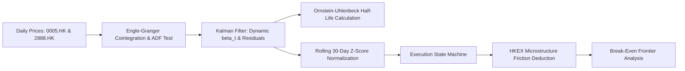

# Empirical Statistical Arbitrage on HKEX Equities
### State-Space Dynamic Hedge Ratios and Market Microstructure Frictions

[](https://hkex-qfin.streamlit.app)


An empirical statistical arbitrage engine and backtesting pipeline applied to dual-listed banking equities on the Hong Kong Stock Exchange (HKEX): **HSBC Holdings (`0005.HK`)** and **Standard Chartered (`2888.HK`)**.

The model addresses two common flaws in naive pairs trading:
1. **Regime Drift:** Rather than relying on static linear regression or rolling-window OLS (which introduces lag and arbitrary window selection), time-varying hedge ratios ($\beta_t$) are estimated recursively via a 2D discrete-time **Kalman Filter**.
2. **Execution Reality:** The backtest explicitly incorporates the statutory **0.10% HKEX stamp duty**, regulatory levies, borrow costs, and bid-ask slippage. 

The strategy demonstrates that while gross mean-reversion alpha is positive, high turnover across HKEX cash equities creates an insurmountable fee drag. Strategy viability requires execution via **Single-Stock Futures (SSFs)**, which are statutorily exempt from stamp duty under Hong Kong law.

🔗 **Live Terminal:** [hkex-qfin.streamlit.app](https://hkex-qfin.streamlit.app)

---

## Architecture Overview



---

## Econometric Methodology

### 1. Cointegration & Stationarity
Asset prices $P_t$ are non-stationary random walks ($P_t \sim I(1)$). Cointegration requires finding a linear combination that yields a stationary series ($S_t \sim I(0)$):
$$S_t = Y_t - (\alpha + \beta X_t)$$

Stationarity is verified using the Augmented Dickey-Fuller (ADF) test on the residuals:
$$\Delta \hat{\epsilon}_t = \gamma \hat{\epsilon}_{t-1} + \sum_{i=1}^p \psi_i \Delta \hat{\epsilon}_{t-i} + u_t$$
Using MacKinnon critical values to reject the unit root null hypothesis ($H_0: \gamma = 0$).

### 2. Recursive 2D State-Space Model
The hedge ratio is modeled as an unobserved state vector $\theta_t = [\alpha_t, \beta_t]^T$:

* **State Dynamics (Random Walk):**
  $$\theta_t = \theta_{t-1} + w_t, \quad w_t \sim \mathcal{N}\left(0, W_t = \frac{\delta}{1-\delta}I_2\right), \quad \delta = 10^{-4}$$
* **Measurement Dynamics:**
  $$Y_t = H_t \theta_t + v_t, \quad v_t \sim \mathcal{N}(0, V), \quad H_t = [1, X_t], \quad V = 1.0$$
* **Update Equations:**
  $$\hat{\theta}_{t\vert{}t-1} = \hat{\theta}_{t-1\vert{}t-1}$$
  $$R_{t\vert{}t-1} = R_{t-1\vert{}t-1} + W_t$$
  $$e_t = Y_t - H_t \hat{\theta}_{t\vert{}t-1}$$
  $$Q_t = H_t R_{t\vert{}t-1} H_t^T + V$$
  $$K_t = R_{t\vert{}t-1} H_t^T Q_t^{-1}$$
  $$\hat{\theta}_{t\vert{}t} = \hat{\theta}_{t\vert{}t-1} + K_t e_t$$
  $$R_{t\vert{}t} = (I_2 - K_t H_t) R_{t\vert{}t-1}$$

### 3. Spread Persistence (Ornstein-Uhlenbeck Process)
The filtered spread $S_t = Y_t - (\alpha_t + \beta_t X_t)$ is modeled as a continuous-time mean-reverting process:
$$dS_t = \theta_{\text{OU}}(\mu - S_t)dt + \sigma dW_t$$

Discretizing into an AR(1) model ($\Delta S_t = a + b S_{t-1} + \epsilon_t$) yields the empirical mean-reversion half-life:
$$\tau_{1/2} = \frac{\ln(2)}{\theta_{\text{OU}}} = -\frac{\ln(2)}{b} \approx \mathbf{1.30 \text{ trading days}}$$

---

## Signal Logic & Friction Modeling

### Dimensionless Normalization
Signals are generated from a 30-day rolling Z-score:
$$Z_t = \frac{S_t - \mu_{30}(S_t)}{\sigma_{30}(S_t)}$$

* **Long Spread Entry ($Z_t \le -2.0$):** Long 1.0 unit HSBC, Short $\beta_t$ units StanChart.
* **Short Spread Entry ($Z_t \ge +2.0$):** Short 1.0 unit HSBC, Long $\beta_t$ units StanChart.
* **Exit to Cash ($Z_t$ crosses $0.0$ or $\vert{}Z_t\vert{} \le 0.5$):** Close all open positions.
* **Emergency Stop-Loss ($\vert{}Z_t\vert{} \ge 3.5$):** Liquidate immediately.

*All orders execute at $t+1$ to eliminate lookahead bias.*

### HKEX Cash Equity Cost Schedule
| Cost Parameter | Rate / Basis |
| :--- | :--- |
| **HKEX Statutory Stamp Duty** | 10.0 bps (0.10% each side on stock transfer) |
| **SFC, AFRC, and Clearing Levies** | 1.05 bps |
| **Institutional Prime Brokerage** | 2.00 bps |
| **Half-Spread Slippage** | 2.00 bps |
| **Total Cash Friction Per Leg** | **15.05 bps** |
| **Annual Short Borrow Financing** | 200 bps p.a. (accrued daily) |

---

## Empirical Results (5-Year Historical Sample)

Sample Period: **January 1, 2021 to January 1, 2026** ($N = 1,230$ trading days)  
Pair: **HSBC (`0005.HK`) vs. Standard Chartered (`2888.HK`)**

| Metric | Gross Strategy (Zero Cost) | Net Strategy (HKEX Cash Equity) | 50/50 Buy & Hold Benchmark |
| :--- | :--- | :--- | :--- |
| **Cumulative Total Return** | **+21.06%** | **-4.10%** | +28.40% |
| **CAGR** | **+4.00%** | -0.83% | +5.12% |
| **Annualized Volatility ($\sigma$)** | 7.61% | 7.60% | 14.80% |
| **Sharpe Ratio ($R_f = 3.0\%$)** | **+0.13** | -0.51 | +0.14 |
| **Sortino Ratio** | **+0.17** | -0.63 | +0.19 |
| **Maximum Drawdown** | **-11.29%** | -15.24% | -23.40% |
| **Total Trade Adjustments** | **85 trades** | 85 trades | 0 |
| **Spread Half-Life ($\tau_{1/2}$)** | **1.30 Days** | 1.30 Days | — |
| **Transaction Cost Drag** | — | **-25.16%** | — |

---

## Key Finding: The Break-Even Friction Frontier

Evaluating net performance across varying transaction fees identifies the break-even threshold where strategy Sharpe ratio falls to zero:
$$c^* = \mathbf{2.53 \text{ bps per leg}}$$

Because live cash equity execution costs **15.05 bps per leg**, the statutory 0.10% stamp duty erodes 25.16% of capital across 85 trades, making cash equities unviable for this strategy.

### Derivative Execution: Single-Stock Futures (SSFs)
Under Schedule 1 of the Hong Kong *Stamp Duty Ordinance* (Cap. 117), exchange-traded futures contracts are **statutorily exempt from stamp duty**. 

Executing through HKEX Single-Stock Futures incurs:
* Exchange fee + SFC levy: ~0.80 bps
* Prime brokerage + slippage: ~1.50 bps
* **Total single-leg friction: ~2.30 to 2.50 bps**

Routing execution through Single-Stock Futures places costs directly inside the 2.53 bps viability frontier, preserving gross mean-reversion alpha.

---

## Repository Structure

```text
hkex-stat-arb/
├── app.py                      # Interactive Streamlit analytics workstation
├── requirements.txt            # Python dependencies
├── README.md                   # System documentation
├── src/
│   ├── econometrics.py         # ADF test, Engle-Granger, OU half-life
│   ├── kalman.py               # 2D Kalman filter & rolling Z-score
│   ├── backtest.py             # Event-driven backtester & friction ledger
│   └── metrics.py              # Performance tearsheet & frontier mapping
└── paper/
    └── hkex_statistical_arbitrage_paper.pdf # Academic working paper
```

---

## Local Installation

```bash
git clone [https://github.com/sanaprabhakar/hkex-stat-arb.git](https://github.com/sanaprabhakar/hkex-stat-arb.git)
cd hkex-stat-arb

# Set up environment
python3 -m venv venv
source venv/bin/activate  # On Windows: venv\Scripts\activate

# Install dependencies and run
pip install -r requirements.txt
streamlit run app.py
```

---

## Author & Academic Purpose

* **Author:** Prabhakar Sana  
* **Context:** Independent research portfolio for HKU BSc Quantitative Finance admissions.  
* **Live Dashboard:** [hkex-qfin.streamlit.app](https://hkex-qfin.streamlit.app)
