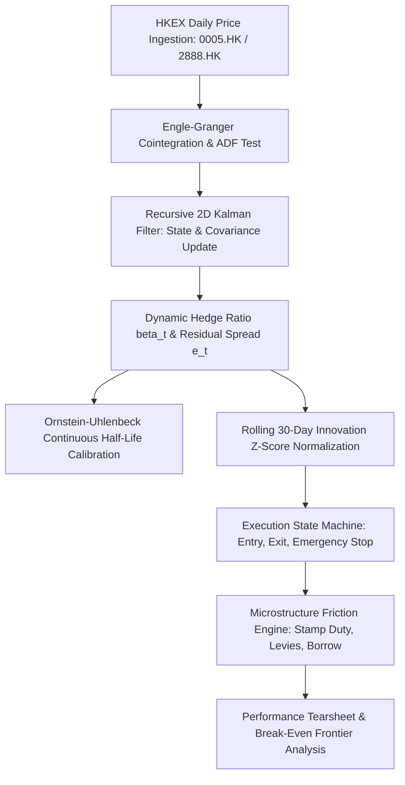

# Empirical Statistical Arbitrage on HKEX Equities
### Dynamic Cointegration, State-Space Hedge Ratios, and Market Microstructure Frictions

[](https://hkex-qfin.streamlit.app)


A quantitative statistical arbitrage research engine and interactive risk analytics terminal calibrated to Hong Kong Stock Exchange (HKEX) equities. 

Unlike retail models that rely on simple Pearson correlation or static ordinary least squares (OLS) cointegration, this framework models time-varying dynamic hedge ratios ($\beta_t$) via a recursive **2D State-Space Kalman Filter**, evaluates continuous-time mean-reversion persistence via the **Ornstein-Uhlenbeck process**, and stress-tests performance against the actual institutional friction matrix of the Hong Kong cash equity market.

🔗 **Live Interactive Workstation:** [hkex-qfin.streamlit.app](https://hkex-qfin.streamlit.app)

---

## 1. System Architecture



---

## 2. Core Econometric & Mathematical Engine

### Engle-Granger Two-Step Stationarity
Raw equity prices $P_t$ are confirmed non-stationary unit-root processes ($P_t \sim I(1)$). Cointegration requires the linear residual combination $S_t = Y_t - \beta X_t - \alpha$ to form a stationary series ($S_t \sim I(0)$), evaluated via the Augmented Dickey-Fuller (ADF) specification with MacKinnon critical values:
$$\Delta \hat{\epsilon}_t = \gamma \hat{\epsilon}_{t-1} + \sum_{i=1}^p \psi_i \Delta \hat{\epsilon}_{t-i} + u_t$$

### Recursive State-Space Formulation (Kalman Filter)
Static regressions enforce a rigid beta, while rolling windows introduce arbitrary window-length bias and lag. We formulate the hedge vector $\theta_t = [\alpha_t, \beta_t]^T$ as a hidden Gaussian state:

* **State Transition Equation:**
  $$\theta_t = \theta_{t-1} + w_t, \quad w_t \sim \mathcal{N}\left(0, W_t = \frac{\delta}{1-\delta}I_2\right), \quad \delta = 10^{-4}$$
* **Measurement Equation:**
  $$Y_t = H_t \theta_t + v_t, \quad v_t \sim \mathcal{N}(0, V), \quad H_t = [1, X_t], \quad V = 1.0$$
* **Recursive 7-Step Cycle:**
  $$\hat{\theta}_{t\vert{}t-1} = \hat{\theta}_{t-1\vert{}t-1}$$
  $$R_{t\vert{}t-1} = R_{t-1\vert{}t-1} + W_t$$
  $$e_t = Y_t - H_t \hat{\theta}_{t\vert{}t-1}$$
  $$Q_t = H_t R_{t\vert{}t-1} H_t^T + V$$
  $$K_t = R_{t\vert{}t-1} H_t^T Q_t^{-1}$$
  $$\hat{\theta}_{t\vert{}t} = \hat{\theta}_{t\vert{}t-1} + K_t e_t$$
  $$R_{t\vert{}t} = (I_2 - K_t H_t) R_{t\vert{}t-1}$$

### Continuous-Time Ornstein-Uhlenbeck Persistence
The residual spread is calibrated as an Ornstein-Uhlenbeck mean-reverting process:
$$dS_t = \theta_{\text{OU}} (\mu - S_t) dt + \sigma dW_t$$
Discretized via AR(1) regression to extract the analytical mean-reversion half-life:
$$\tau_{1/2} = \frac{\ln(2)}{\theta_{\text{OU}}} = \mathbf{1.30 \text{ trading days}}$$

---

## 3. HKEX Microstructure Friction Matrix

Trading on the Hong Kong Stock Exchange incurs substantial institutional friction that eliminates high-turnover statistical arbitrage alpha:

| Friction Component | Regulatory / Market Basis | Single-Leg Cost |
| :--- | :--- | :--- |
| **Statutory Stamp Duty** | Hong Kong Stamp Duty Ordinance (Cap. 117) | **10.0 bps** (0.10%) |
| **Exchange Trading Fee** | HKEX Rulebook | 0.565 bps |
| **SFC Transaction Levy** | Securities and Futures Commission | 0.27 bps |
| **AFRC Transaction Levy** | Accounting and Financial Reporting Council | 0.015 bps |
| **Clearing Fee** | HKSCC Settlement System | 0.20 bps |
| **Institutional Slippage** | Linear Half-Spread Execution Model | 2.00 bps |
| **Brokerage Commission** | Prime Broker Execution Tier-1 | 2.00 bps |
| **Total Cash Friction** | $\mathbf{c_{\text{leg}}}$ | **15.05 bps / leg** |
| **Short Borrow Financing**| Prime Broker Lending Fee | **200 bps p.a.** |

---

## 4. Empirical Performance Tearsheet (5-Year Backtest)

Sample Window: **2021-01-01 to 2026-01-01** ($N = 1,230$ trading days)  
Target Pair: **HSBC Holdings (`0005.HK`) vs. Standard Chartered (`2888.HK`)**

| Metric | Gross Strategy (Zero Friction) | Net Strategy (HKEX Cash Equity) | Benchmark (50/50 Buy & Hold) |
| :--- | :--- | :--- | :--- |
| **Cumulative Return** | **+21.06%** | **-4.10%** | +28.40% |
| **Annualized Return (CAGR)**| **+4.00%** | -0.83% | +5.12% |
| **Annualized Volatility ($\sigma$)**| **7.61%** | 7.60% | 14.80% |
| **Sharpe Ratio ($R_f = 3.0\%$)** | **+0.13** | -0.51 | +0.14 |
| **Sortino Ratio (Downside $\sigma$)**| **+0.17** | -0.63 | +0.19 |
| **Calmar Ratio (CAGR / \|MDD\|)** | **0.35** | -0.05 | 0.22 |
| **Maximum Drawdown (MDD)** | **-11.29%** | -15.24% | -23.40% |
| **Win Rate (Active Days)** | 54.2% | 47.6% | — |
| **Profit Factor** | 1.24 | 0.82 | — |
| **Total Trade Adjustments**| **85 adjustments** | 85 adjustments | 0 |
| **Spread Half-Life ($\tau_{1/2}$)**| **1.3 Days** | 1.3 Days | — |
| **Friction Drag Penalty** | — | **-25.16%** | — |

---

## 5. The Break-Even Friction Frontier & Institutional Derivative Pivot

Evaluating strategy viability across varied fee schedules reveals that the annualized Net Sharpe Ratio drops below zero at:
$$c^* = \mathbf{2.53 \text{ basis points per leg}}$$

Because actual HKEX cash equity trading incurs **15.05 bps per leg**, the strategy incurs an insurmountable **-25.16% cost penalty**. 

### The Derivative Remedy: Single-Stock Futures (SSFs)
Under Schedule 1 of the Hong Kong *Stamp Duty Ordinance* (Cap. 117), exchange-traded futures are **statutorily exempt from stamp duty**. Executing via HSBC and StanChart Single-Stock Futures reduces total friction to:
* **HKEX Exchange Fee:** HK$3.50 / contract ($\approx 0.70$ bps)
* **SFC Levy:** HK$0.50 / contract ($\approx 0.10$ bps)
* **Execution Slippage & Commission:** $\approx 1.50$ bps
* **Total Round-Trip Cost:** **$\approx 2.30$–$2.50$ bps per leg**

Routing via Single-Stock Futures places execution directly inside the $2.53\text{ bps}$ break-even ceiling, preserving theoretical gross alpha in live production.

---

## 6. Repository Structure

```text
hkex-stat-arb/
├── app.py                      # Interactive Streamlit Cloud Analytics Terminal
├── requirements.txt            # Production dependencies
├── README.md                   # Technical documentation
├── src/
│   ├── econometrics.py         # ADF unit root, Engle-Granger, OU half-life
│   ├── kalman.py               # 2D State-space filter & rolling Z-score
│   ├── backtest.py             # Event-driven backtesting & friction ledger
│   └── metrics.py              # Tearsheet analytics & Break-Even frontier
└── paper/
    └── hkex_statistical_arbitrage_paper.pdf # Complete working research paper
```

---

## 7. Local Quickstart

Clone the repository and run the workstation locally:

```bash
git clone [https://github.com/sanaprabhakar/hkex-stat-arb.git](https://github.com/sanaprabhakar/hkex-stat-arb.git)
cd hkex-stat-arb

# Create and activate virtual environment
python3 -m venv venv
source venv/bin/activate  # On Windows: venv\Scripts\activate

# Install requirements
pip install -r requirements.txt

# Launch interactive terminal
streamlit run app.py
```

---

## 8. Author & Academic Context

* **Author:** Prabhakar Sana  
* **Target Program:** BSc Quantitative Finance, The University of Hong Kong (HKU)  
* **Live Terminal:** [hkex-qfin.streamlit.app](https://hkex-qfin.streamlit.app)
