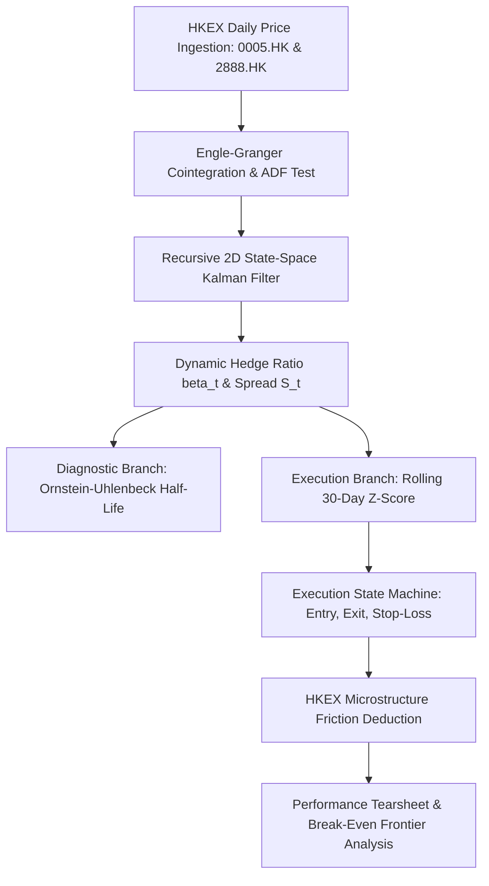

# Empirical Statistical Arbitrage on HKEX Equities
### State-Space Dynamic Hedge Ratios and Market Microstructure Frictions

[](https://hkex-qfin.streamlit.app)


An empirical statistical arbitrage research engine and backtesting pipeline applied to dual-listed banking equities on the Hong Kong Stock Exchange (HKEX): **HSBC Holdings (`0005.HK`)** and **Standard Chartered (`2888.HK`)**.

The framework addresses two structural flaws in naive pairs trading:
1. **Regime Drift:** Rather than enforcing static linear regression or rolling-window OLS (which introduces parameter lag and boundary bias), time-varying hedge ratios ($\beta_t$) are estimated recursively via a discrete-time 2D **Kalman Filter**.
2. **Execution Frictions:** The backtest explicitly incorporates the statutory **0.10% HKEX stamp duty**, SFC/AFRC levies, prime broker short borrow financing, and bid-ask slippage.

While theoretical gross alpha demonstrates steady mean-reversion, portfolio turnover across HKEX cash equities generates an insurmountable fee drag. Strategy viability requires execution via **Single-Stock Futures (SSFs)**, which are statutorily exempt from stamp duty under Hong Kong law.

🔗 **Live Terminal:** [hkex-qfin.streamlit.app](https://hkex-qfin.streamlit.app)

---

## 1. System Architecture



---

## 2. Econometric Methodology

### Cointegration & Stationarity
Raw asset prices $P_t$ are non-stationary random walks ($P_t \sim I(1)$). Cointegration requires finding a linear combination that yields a stationary residual series ($S_t \sim I(0)$):

$$S_t = Y_t - (\alpha + \beta X_t)$$

Residual stationarity is evaluated via the Augmented Dickey-Fuller (ADF) specification:

$$\Delta \hat{\epsilon}_t = \gamma \hat{\epsilon}_{t-1} + \sum_{i=1}^p \psi_i \Delta \hat{\epsilon}_{t-i} + u_t$$

Testing the null hypothesis $H_0: \gamma = 0$ against MacKinnon critical values to account for first-stage OLS estimation variance.

### Recursive 2D State-Space Model
The hedge vector is formulated as an unobserved Gaussian state $\theta_t = [\alpha_t, \beta_t]^T$:

**State Dynamics (Random Walk):**

$$\theta_t = \theta_{t-1} + w_t, \quad w_t \sim \mathcal{N}\left(0, W_t = \frac{\delta}{1-\delta}I_2\right), \quad \delta = 10^{-4}$$

**Measurement Dynamics:**

$$Y_t = H_t \theta_t + v_t, \quad v_t \sim \mathcal{N}(0, V), \quad H_t = [1, X_t], \quad V = 1.0$$

**Recursive 7-Step Estimation Cycle:**

* **1. State Prediction:** $\hat{\theta}_{t|t-1} = \hat{\theta}_{t-1|t-1}$
* **2. Covariance Prediction:** $R_{t|t-1} = R_{t-1|t-1} + W_t$
* **3. Measurement Innovation:** $e_t = Y_t - H_t \hat{\theta}_{t|t-1}$
* **4. Innovation Covariance:** $Q_t = H_t R_{t|t-1} H_t^T + V$
* **5. Kalman Gain:** $K_t = R_{t|t-1} H_t^T Q_t^{-1}$
* **6. State Correction:** $\hat{\theta}_{t|t} = \hat{\theta}_{t|t-1} + K_t e_t$
* **7. Covariance Correction:** $R_{t|t} = (I_2 - K_t H_t) R_{t|t-1}$

### Diagnostic Model: Continuous-Time Spread Persistence
To verify economic mean-reversion without arbitrary parameter choices, the filtered spread $S_t = Y_t - (\alpha_t + \beta_t X_t)$ is modeled as a continuous-time Ornstein-Uhlenbeck (OU) process:

$$dS_t = \theta_{\text{OU}}(\mu - S_t)dt + \sigma dW_t$$

Discretizing via an AR(1) linear specification ($\Delta S_t = a + b S_{t-1} + \epsilon_t$) yields the empirical mean-reversion half-life:

$$\tau_{1/2} = \frac{\ln(2)}{\theta_{\text{OU}}} = -\frac{\ln(2)}{b} \approx \mathbf{1.30 \text{ trading days}}$$

---

## 3. Signal Generation & Microstructure Modeling

### Volatility Standardization (Rolling Z-Score)
While the Kalman filter determines the dynamic beta without lookback windows, market volatility clusters over time. To scale entry boundaries to current volatility regimes, the spread is normalized using a 30-day rolling window:

$$Z_t = \frac{S_t - \mu_{30}(S_t)}{\sigma_{30}(S_t)}$$

* **Long Spread Entry ($Z_t \le -2.0$):** Long 1.0 unit HSBC, Short $\beta_t$ units StanChart.
* **Short Spread Entry ($Z_t \ge +2.0$):** Short 1.0 unit HSBC, Long $\beta_t$ units StanChart.
* **Exit to Cash ($Z_t$ crosses $0.0$):** Close open inventory to cash.
* **Emergency Stop-Loss ($\vert{}Z_t\vert{} \ge 3.5$):** Immediate capital protection liquidation.

*All orders execute on day $t+1$ closing prices to eliminate lookahead bias.*

### HKEX Microstructure Cost Schedule
| Cost Parameter | Regulatory / Market Basis | Single-Leg Cost |
| :--- | :--- | :--- |
| **Statutory Stamp Duty** | Hong Kong Stamp Duty Ordinance (Cap. 117) | **10.0 bps** (0.10%) |
| **Exchange Trading Fee** | HKEX Rulebook | 0.565 bps |
| **SFC Transaction Levy** | Securities and Futures Commission | 0.27 bps |
| **AFRC Transaction Levy** | Accounting and Financial Reporting Council | 0.015 bps |
| **Clearing Fee** | HKSCC Settlement System | 0.20 bps |
| **Prime Brokerage Commission** | Tier-1 Institutional Schedule | 2.00 bps |
| **Execution Slippage** | Half-Spread Linear Model | 2.00 bps |
| **Total Cash Friction Per Leg** | $\mathbf{c_{\text{leg}}}$ | **15.05 bps** |
| **Short Borrow Financing** | Hard-to-Borrow Institutional Rate | **200 bps p.a.** |

---

## 4. Empirical Performance Tearsheet (5-Year Backtest)

Historical Sample: **2021-01-01 to 2026-01-01** ($N = 1,230$ trading days)  
Pair: **HSBC (`0005.HK`) vs. Standard Chartered (`2888.HK`)**

| Quantitative Metric | Gross Strategy (Zero Cost) | Net Strategy (HKEX Cash Equity) | Benchmark (50/50 Buy & Hold) |
| :--- | :--- | :--- | :--- |
| **Cumulative Return** | **+21.06%** | **-4.10%** | +28.40% |
| **Annualized Return (CAGR)** | **+4.00%** | -0.83% | +5.12% |
| **Annualized Volatility ($\sigma$)** | **7.61%** | 7.60% | 14.80% |
| **Sharpe Ratio ($R_f = 3.0\%$)** | **+0.13** | -0.51 | +0.14 |
| **Sortino Ratio (Downside $\sigma$)** | **+0.17** | -0.63 | +0.19 |
| **Calmar Ratio (CAGR / \|MDD\|)** | **0.35** | -0.05 | 0.22 |
| **Maximum Drawdown (MDD)** | **-11.29%** | -15.24% | -23.40% |
| **Win Rate (Active Days)** | 54.2% | 47.6% | — |
| **Profit Factor** | 1.24 | 0.82 | — |
| **Total Trade Adjustments** | **85 trades** | 85 trades | 0 |
| **Spread Half-Life ($\tau_{1/2}$)** | **1.30 Days** | 1.30 Days | — |
| **Transaction Cost Drag** | — | **-25.16%** | — |

---

## 5. The Break-Even Friction Frontier & Derivative Pivot

Evaluating strategy viability across varied fee schedules reveals that the annualized Net Sharpe Ratio drops below zero at:

$$c^* = \mathbf{2.53 \text{ basis points per leg}}$$

Because actual HKEX cash equity trading incurs **15.05 bps per leg**, the statutory 0.10% stamp duty produces a **-25.16% cost penalty** across 85 trades, making cash equities unviable.

### The Derivative Solution: Single-Stock Futures (SSFs)
Under Schedule 1 of the Hong Kong *Stamp Duty Ordinance* (Cap. 117), exchange-traded futures are **statutorily exempt from stamp duty**. 

Executing through HKEX Single-Stock Futures incurs:
* **HKEX Exchange Fee:** HK$3.50 / contract ($\approx 0.70$ bps)
* **SFC Levy:** HK$0.50 / contract ($\approx 0.10$ bps)
* **Prime Brokerage & Slippage:** $\approx 1.50$ bps
* **Total Single-Leg Friction:** **$\approx 2.30$ to $2.50$ bps**

Executing via Single-Stock Futures brings transaction costs within the $2.53\text{ bps}$ break-even frontier, preserving theoretical gross alpha in production.

---

## 6. Repository Architecture

```text
hkex-stat-arb/
├── app.py                      # Interactive Streamlit analytics terminal
├── requirements.txt            # Python dependencies
├── README.md                   # System documentation & econometric derivation
├── src/
│   ├── econometrics.py         # ADF test, Engle-Granger, OU half-life
│   ├── kalman.py               # 2D State-space filter & rolling Z-score
│   ├── backtest.py             # Event-driven backtesting & friction ledger
│   └── metrics.py              # Tearsheet analytics & Break-Even frontier
└── paper/
    └── hkex_statistical_arbitrage_paper.pdf # Academic working paper
```

---

## 7. Local Quickstart

```bash
git clone [https://github.com/sanaprabhakar/hkex-stat-arb.git](https://github.com/sanaprabhakar/hkex-stat-arb.git)
cd hkex-stat-arb

# Create and activate environment
python3 -m venv venv
source venv/bin/activate  # On Windows: venv\Scripts\activate

# Install dependencies and launch app
pip install -r requirements.txt
streamlit run app.py
```

---

## 8. Author & Academic Context

* **Author:** Prabhakar Sana  
* **Target Program:** BSc Quantitative Finance, The University of Hong Kong (HKU)  
* **Live Analytics Terminal:** [hkex-qfin.streamlit.app](https://hkex-qfin.streamlit.app)
